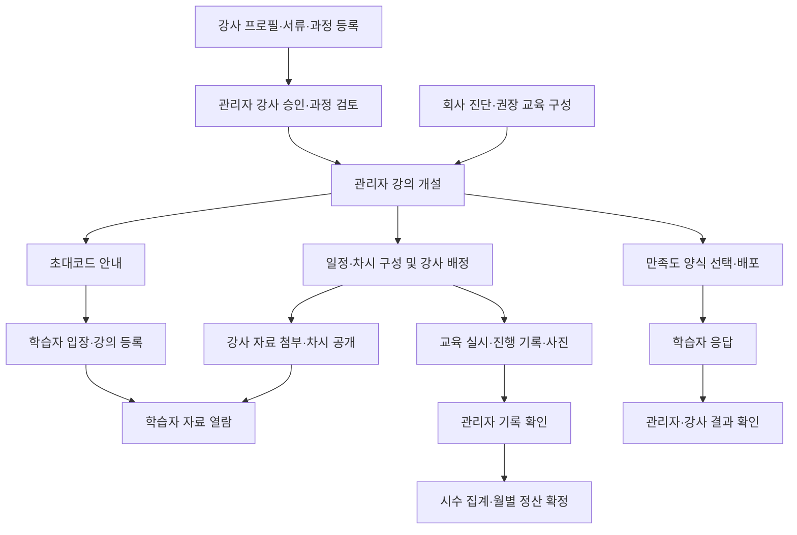

# ClassFit 요구정의서 — 관리자·강사·학습자 시안 통합

| 항목 | 내용 |
|---|---|
| 문서 버전 | v1.0 · 검토용 |
| 작성일 | 2026-10-21 |
| 대상 서비스 | BCTONE AX 교육 운영 플랫폼 ClassFit |
| 작성 목적 | 세 역할의 HTML 시안에 담긴 기능, 권한, 업무 규칙, 데이터와 검수 기준을 개발·기획 검토에 사용할 수 있도록 정의 |
| 주 분석 범위 | `시안/관리자.html`, `시안/강사.html`, `시안/학습자.html`의 화면 문구·입력 항목·이벤트 처리·상태 분기 |
| 문서 성격 | 시안 전체의 요구사항 목록. 기존 승인된 개발 계획을 변경하거나 모든 기능의 1차 개발을 확정하는 문서가 아님 |

## 1. 문서 해석과 근거

세 시안은 디자인 대안 세 개가 아니라 **관리자·강사·학습자의 역할별 화면**이다. 강의 개설 → 강사 배정 → 자료 준비 → 학습자 입장 → 교육 기록 → 만족도 조사로 연결되는 하나의 서비스를 정의한다.

요구사항은 다음 기준으로 구분한다.

- **시안**: 화면 문구와 동작에서 직접 확인한 요구. 승인 완료를 뜻하지 않는다.
- **기존 결정**: 저장소의 승인 상태 ADR에 명시된 규칙. 해당 사항은 시안과 달라도 결정 내용을 함께 표시한다.
- **보완 제안**: 시안의 업무를 실제 서비스에서 일관되게 처리하기 위한 제안. 별도 합의 전 확정 정책으로 취급하지 않는다.
- **결정 필요**: 시안 간 불일치, 누락 또는 구현 범위 조정이 필요한 항목. §10의 `DEC` 번호로 관리한다.

시안의 예시 인명·회사·강의·날짜·건수는 테스트 데이터이며 실제 운영값이나 성능 목표로 간주하지 않는다. 개발용 역할 전환, 샘플 채우기, 연동 초기화, localStorage 저장 및 다운로드·이메일 전송 토스트도 제품 기능의 완료 근거가 아니다. 본 문서는 소스 분석 결과이며 브라우저 실동작·서버 구현을 검증한 결과가 아니다.

### 1.1 근거 문서

| 코드 | 파일 | 주요 근거 위치 |
|---|---|---|
| A | [관리자 시안](../../시안/관리자.html) | `renderInstructors`, `renderPool`, `renderCourseNew`, `renderCourseEdit`, `renderCourseRecords`, `renderCalendar`, `renderSettlement`, `renderDiag`, `renderReport`, `renderSurveys`, `renderSettings` |
| I | [강사 시안](../../시안/강사.html) | `renderHome`, `renderProfile`, `renderMyCourses`, `curBody`, `renderCourse`, `renderAttach`, `renderCode`, `renderStudents`, `renderCourseRec`, `renderCalendar`, `renderHours`, `renderSurvey` |
| L | [학습자 시안](../../시안/학습자.html) | `renderEnter`, `renderPortal`, `renderGuide`, `renderViewer`, `renderSurvey` |
| D2 | [ADR-002 학습자 세션](../process/adr/ADR-002-learner-session.md) | 강의 범위 세션, 현재 코드로 재입장, 강의별 이름·부서, 기본 수명 1일 |
| D3 | [ADR-003 파일·메일·문서 열기](../process/adr/ADR-003-external-ports.md) | 권한을 확인한 파일 제공, outbox, 1차 PDF·HTML 열기 유보, 파일 바이트 삭제 유예 |
| P1 | 기존 1차 계획 r3 `../../.omc/plans/2026-10-21-classfit-phase1-r3.md` | §7 및 부록 A3의 시안 전용 기능 범위. 로컬·gitignore 문서이므로 공유본에서는 접근되지 않을 수 있음 |

이하 근거의 `A:함수명`은 관리자 시안의 해당 함수와 연결 UI를 뜻한다. 요구 ID는 본 문서에서 부여한 식별자이며 시안의 기존 화면 번호를 대체하지 않는다. `기획/`의 문서와 공개홈은 이번 세 시안 분석의 주 범위에 포함하지 않았다.

### 1.2 기존 1차 개발 범위와의 관계

| 항목 | 시안 전체 요구 | 기존 계획·ADR의 1차 처리 |
|---|---|---|
| 개인 일정·배정 겹침 알림 | 포함: CAL-001~004 | P1 부록 A3에서 제외 |
| 시수·월별 정산 확정 | 포함: HRS-001~004 | P1 부록 A3에서 제외 |
| 강사 서류 항목 설정 | 포함: SET-002 | 종류 데이터 구조만 포함, 편집 API는 2차 |
| 강사위촉계약서 | 포함: INS-006 | P1 부록 A3에서 제외 |
| 가능 과정 확인·보완 요청 | 포함: CAT-003 | 상세 흐름은 제외, reviewed 토글만 반영 |
| 실제 이메일 발송 | 최종 제품 요구에 포함 | D3: 발송하지 않고 outbox에 적재 |
| PDF·HTML 패키지 열기 | 최종 제품 요구에 포함 | D3: 1차 열기 501, 보관 중심. 최종 제품 완료와 구분 |
| 기본 강사 서류 | 시안에 필수 4종 | P1은 기획안 기준 3종을 시드로 삼음. 최종 항목은 DEC-006 |

아래 우선도는 **제품 업무 의존성에 따른 제안**이다. `필수`는 해당 업무를 제공할 때 필요한 핵심 규칙, `운영`은 관리 효율을 위한 기능이다. 우선도가 기존 1차 제외 결정을 뒤집지는 않는다.

## 2. 서비스 목적과 범위

교육 운영자가 강사와 교육과정을 관리하고, 고객사별 강의를 편성하여 자료 제공·교육 실시·결과 확인까지 운영할 수 있어야 한다. 강사는 자신의 전문 과정과 배정 차시를 관리하고, 학습자는 별도 비밀번호 없이 강의에 입장하여 자료 열람과 만족도 응답을 수행한다.

| 범위 | 포함 내용 |
|---|---|
| 강사 운영 | 프로필, 제출 서류, 승인·반려·정지, 가능 분야, 계약서, 관리자 메모·이력 |
| 교육과정 운영 | AX 과정, 강사 고유 과정, 다일차 커리큘럼, 심화 과정, 검토·수정 요청·공개 설정 |
| 강의 운영 | 네 가지 개설 방식, 섹션·차시, 일정, 담당 강사, 초대코드, 수강생, 자료, 교육 사진 |
| 실시 관리 | 계획 대비 교육 기록, 관리자 확인, 시수 조회, 월별 시수 확정 |
| 교육 효과 | 회사별 AX 사전·사후 진단, 권장 교육 구성, 만족도 양식·배포·응답·집계 |
| 공통 운영 | 역할별 접근 제어, 알림, 파일·내보내기, 공통 코드 설정, 처리 이력 |

다음은 이번 시안에서 독립된 기능으로 정의되지 않았거나 명시적으로 후속 범위이다: 수강료 결제, 수당 단가·지급·세무 계산, 개인별 출결부, 시험·과제 제출·채점, 수료증 발급, 강의안 본문 편집기, 기업 담당자 전용 로그인 포털, 심화 과정 카드와 커리큘럼의 자동 연결. 자료에 포함된 ‘과제’ 문구는 과제 관리 기능을 뜻하지 않는다. 공개홈의 회원가입·홍보·문의 화면과 기업 자가진단 응답 화면은 연결 지점만 정의한다.

## 3. 사용자와 권한

### 3.1 역할 정의

| 역할 | 목적·접근 범위 |
|---|---|
| 관리자 | 전체 강사·강의·회사·진단·설문·설정 관리. 시안상 관리자 등급은 하나이며 기존 관리자가 계정을 생성 |
| 승인 대기 강사 | 자신의 프로필·서류·내 과정 작성. 승인 전 신규 강의 배정 후보에 포함되지 않음 |
| 승인 강사 | 자신의 과정 및 배정 강의 열람, 본인 차시의 자료·설명·공개·교육 기록 관리 |
| 반려·정지 강사 | 관리자 상태로 존재. 로그인·편집 가능 범위와 기존 배정 영향은 DEC-005 |
| 학습자 | 해당 강의의 현재 초대코드와 이메일로 입장. 등록한 강의의 공개 자료와 본인 설문 참여만 이용 |
| 기업 진단 응답자 | 관리자 발급 링크로 회사 대표 1명이 응답. 별도 회사 계정은 없으며 응답 화면은 공개홈 연동 범위 |

### 3.2 권한 매트릭스

| 기능·정보 | 관리자 | 강사 | 학습자 |
|---|---|---|---|
| 강사 프로필·연락처·제출 서류 | 전체 열람·심사 | 본인 작성·열람 | 차시 담당 강사명만 |
| 강사 승인·반려·정지 | 처리 | 상태 확인 | 불가 |
| 강의별 위촉계약서 | 등록·교체·삭제·열람 | 본인 배정 강의의 계약서 열람·다운로드 | 불가 |
| AX 과정 원문 | 추가·편집·사용 중지 | 열람·가능 표시·본인 강의안 추가 | 공개홈 카탈로그는 별도 범위 |
| 강사 고유 과정·커리큘럼 | 검토·공개·사용 중지·수정 요청 | 본인 원문 작성·수정·삭제 | 원문 관리 불가 |
| 다른 강사의 고유 과정 | 작성자·가능 강사 포함 열람 | 내용 열람·가능 표시, 작성자·다른 가능 강사 정보 제외 | 관리 불가 |
| 강의 개설·섹션·차시 구조·담당 배정 | 관리 | 배정된 강의 열람 | 공개된 구성 열람 |
| 차시 제목·설명·키워드·공개 여부 | 관리 | 본인 배정 차시만 수정 | 열람 |
| 배정 차시 강의안 | 열람·다운로드가 시안에 있음 | 본인 차시 업로드·정렬·삭제 | 공개된 자료 열람·다운로드 |
| 초대코드 | 발급·재발급·정지·만료·정원 관리 | 배정 강의의 코드·안내문 조회·복사 | 입장 시 사용 |
| 수강생 명단 | 강의별 등록 현황, 상세 권한은 설계에서 구체화 | 배정 강의 명단·응답 여부 조회·내보내기 | 타인 명단 불가 |
| 교육 기록 | 작성·수정·확인·내보내기 | 본인 차시 작성·수정 | 불가 |
| 교육 사진 | 전체 열람·업로드·설명 수정·삭제·다운로드 | 본인 차시에 업로드, 본인 업로드 사진 수정·삭제 | 불가 |
| 개인 일정 | 전체 조회·겹침 확인 | 본인 등록·수정·삭제 | 불가 |
| 월별 정산 확정 | 확정·취소 | 본인 시수·확정 상태 열람 | 불가 |
| AX 진단 | 회사·회차·링크·리포트 관리 | 시안에 권한 없음 | 시안에 권한 없음 |
| 만족도 양식·배포·마감 | 관리 | 배정 강의 결과 열람 | 대상 설문 1회 응답 |
| 개인과 연결된 설문 답변 | 제공하지 않음 | 제공하지 않음 | 제출 후 수정·재응답 불가 |
| 공통 코드·관리자 계정 | 관리 | 불가 | 불가 |

서버는 화면 버튼 유무와 별개로 역할·계정 상태·강의 등록·차시 배정을 검사해야 한다. 관리자 첨부 업로드는 기존 백엔드 계획의 예외 검토 대상이며 세 시안에서 확인한 관리자 파일 권한과 구분한다.

## 4. 주요 업무 흐름

AX 진단은 강의 개설의 필수 선행조건이 아니다. 강의는 빈 강의·지난 강의 복제·확정 진단 권장 구성·강사 커리큘럼 가져오기로 개설할 수 있다. 강사 승인, 과정 검토, 과정 공개, 차시 공개는 서로 다른 상태이다.

## 5. 기능 요구사항

각 행의 검수 기준은 최종 제품에서 관찰되어야 하는 결과이다. D3에서 유보한 파일 열기·실메일 등은 §1.2의 단계 제한을 적용한다.

### 5.1 공통 접근·홈

| ID | 요구사항·업무 규칙 | 검수 기준 | 우선 | 근거 |
|---|---|---|---|---|
| COM-001 | 관리자는 전용 주소에서 아이디·비밀번호로 로그인한다. 공개홈에 관리자 진입 링크를 두지 않는다. | 잘못된 인증 정보·비활성 계정은 진입 거부, 정상 계정은 관리자 홈 진입 | 필수 | A:renderLogin, renderSettings |
| COM-002 | 역할 및 소유 범위를 검증한다. 강사는 본인 정보·배정 강의, 학습자는 인증된 강의 범위만 접근한다. | 다른 강사·강의 식별자로 요청해도 허용되지 않은 데이터와 파일을 받지 못함 | 필수 | I:renderCourse, renderAttach; D2·D3 |
| COM-003 | 학습자 세션은 강의 하나에 묶고 기본 수명은 1일로 한다. 강의 전환 시 대상 강의 코드와 이메일로 다시 입장한다. | A 강의 세션만으로 B 강의 포털·파일을 열 수 없음 | 필수 | D2; L:topbar와 차이 있음 |
| COM-004 | 관리자 홈에서 승인 대기, 진행 강의, 미배정, 미검토 등록, 열린 설문, 진단 검토 대기, 미기록, 사진·최근 이력을 조회한다. | 요약 건수와 이동한 상세 목록의 조건·건수가 일치 | 운영 | A:renderHome |
| COM-005 | 강사 홈에서 배정 강의, 자료 미첨부 차시, 미제출 서류, 미기록, 수정 요청, 일정·시수·설문 알림을 조회한다. | 본인에게 해당하는 항목만 표시하고 해당 처리 화면으로 이동 | 운영 | I:renderHome |
| COM-006 | 목록 검색·필터·빈 상태·처리 성공·실패를 구분해 안내한다. | 결과 없음과 데이터 없음 구분, 실패한 저장을 완료로 표시하지 않음 | 운영 | A·I·L의 목록·폼; 실패 처리 보완 제안 |

### 5.2 강사·서류

| ID | 요구사항·업무 규칙 | 검수 기준 | 우선 | 근거 |
|---|---|---|---|---|
| INS-001 | 강사는 사진, 이름, 소속, 한 줄 소개, 이메일, 전화, 경력·학력·자격, 강의 분야를 작성한다. 강의 분야는 1개 이상이다. | 저장 후 재조회 일치, 학습자 포털에는 강사명만 노출 | 필수 | I:renderProfile |
| INS-002 | 강의 분야 태그를 검색·선택하고 없는 태그는 새로 등록한다. 신규 태그는 대분류를 지정하고 관리자 정리 대상이 된다. | 중복 선택 방지, 신규 태그가 관리자 설정에 강사 추가 항목으로 표시 | 운영 | I:tagInputHTML, addTag; A:renderTagSettings |
| INS-003 | 강사는 활성 서류 항목별 파일과 이름을 직접 지정한 기타 서류를 등록·삭제한다. 필수 제출 상태를 표시한다. | 파일 삭제 시 해당 항목 미제출로 복귀, 기타 서류 이름 없이 등록 불가 | 필수 | I:docsCardHTML, uploadDoc, etcAdd |
| INS-004 | 관리자는 강사를 검색·상태 필터·정렬하고 기본 정보, 서류, 강의·계약, 메모·이력을 확인한다. 목록을 xlsx로 내보낸다. | 조회 조건과 내보내기 대상 일치, 해당 강사 문서·배정 내역 표시 | 운영 | A:renderInstructors |
| INS-005 | 관리자 승인 조건은 강의 분야 1개 이상과 활성 필수 강사 제출 서류 완비이다. 반려 사유는 필수이며 승인·반려·정지·해제 이력을 남긴다. | 미충족 시 승인 불가, 빈 사유로 반려 불가, 처리자·시각·결과 기록 | 필수 | A:apBlock, renderInstructors |
| INS-006 | 관리자 제출 서류는 강사·강의·서류 유형별로 등록·교체·삭제한다. 강사는 자신의 계약서를 조회·다운로드한다. 승인 조건에는 포함하지 않는다. | 같은 강사의 서로 다른 강의 계약서가 분리되고 강사가 교체·삭제할 수 없음 | 운영 | A:conTableHTML; I:conCardHTML |
| INS-007 | 제출 항목의 필수·선택·중지 변경을 제출 현황에 반영한다. 신분증·통장 사본은 플랫폼 서류 수집 범위에서 제외한다. | 새 필수 항목은 미제출로 표시, 중지한 항목의 기존 파일은 보존 | 필수 | A:renderDocSettings; I:docTypes |

### 5.3 과정 풀·가능 과정·커리큘럼

| ID | 요구사항·업무 규칙 | 검수 기준 | 우선 | 근거 |
|---|---|---|---|---|
| CAT-001 | 관리자는 AX 과정의 명칭, 대상 직무군, 목표, 난이도, 시간, 산출물, 이론·실습·진행표·실습 자료를 추가·편집한다. 식별자는 유지하고 삭제 대신 사용 중지한다. | 편집 후 동일 과정 ID 유지, 비활성 과정은 새 사용 대상에서 제외 | 필수 | A:poolEditRow, poolEditBind |
| CAT-002 | 강사는 과정 풀을 검색·직무군·난이도·출처·가능 여부로 필터하고 가능 표시, 본인 강의안·진행 메모를 관리한다. | 타 강사 원문은 수정할 수 없고 본인 등록 정보만 변경 | 필수 | I:renderMyCourses, axDetail |
| CAT-003 | 관리자는 가능 표시를 확인하거나 사유를 적어 보완 요청한다. 강사는 보완 완료를 알리고 재확인을 받는다. 관리자 추천 배치와 본인 가능 표시는 구분한다. | 미확인·보완 요청·확인 상태 구별, 미확인임을 표시하되 배정을 일괄 차단하지 않음 | 운영 | A:openPlaceModal, renderPool; I:axDetail |
| CAT-004 | 강사는 고유 과정과 기본 강의안을 등록·수정·삭제한다. 과정명과 대상 직무군 1개 이상은 필수이다. | 등록 시 관리자 과정 풀에 미검토로 표시, 다른 강사에게 작성자 정보 노출 없이 내용 제공 | 필수 | I:saveOwn, delOwn; A:renderPool |
| CAT-005 | 강사는 다일차 커리큘럼의 일수, 일별 시작·종료, 교시·휴식, 차시 주제·내용, 목표·산출물·기본 자료를 관리한다. | 차시표 생성·편집 및 저장 후 동일 구조 조회, 실제 날짜는 강의 개설 때 지정 | 필수 | I:curBody, curGrid, saveCur |
| CAT-006 | 고유 과정·커리큘럼의 검토, 수정 요청·철회, 공개, 활성 상태를 관리한다. 원문 수정·수정 요청·검토 해제 시 미검토·비공개로 전환한다. | 미검토 항목 공개 불가, 수정 후 이전 공개 상태 자동 유지되지 않음 | 필수 | A:renderPool; I:saveOwn, saveCur |
| CAT-007 | 과정·커리큘럼을 강의에 가져올 때 내용을 복제한다. 원문 편집·사용 중지·삭제가 개설 강의를 소급 변경하지 않는다. | 원문 삭제 후 기존 강의 주제·구성·자료 참조가 유효하게 유지 | 필수 | A:cloneSections, renderCourseNew; I:delOwn, delCur |
| CAT-008 | 관리자는 심화 과정의 제목, 대상, 도구, 시간, 목표·특징과 공개·활성 상태를 관리한다. | 활성·공개 항목만 외부 카탈로그 제공 대상, 기존 식별자 유지 | 운영 | A:renderPool의 advCard |
| CAT-009 | 공개 카탈로그에는 활성·공개 과정만 제공하고 강사 이름·연락처를 노출하지 않는다. | 미검토 강사 과정, 비공개·비활성 항목, 강사 개인정보가 공개 데이터에 포함되지 않음 | 필수 | A:renderPool 안내; 공개홈 화면 자체는 범위 밖 |

### 5.4 강의 개설·편성·일정

| ID | 요구사항·업무 규칙 | 검수 기준 | 우선 | 근거 |
|---|---|---|---|---|
| CRS-001 | 관리자는 강의 목록을 조회하고 기본 정보를 관리한다. 유형은 사업주훈련·혁신바우처·기업강의·공개 특강, 방식은 집체·ZOOM·혼합이다. | 유형·상태 등의 조건에 따라 조회, 강의별 상세로 이동 | 필수 | A:renderCourseList, TYPE_ALL, METHOD_ALL |
| CRS-002 | 빈 강의, 기존 강의 복제, 확정 진단 권장 구성, 강사 커리큘럼의 네 시작점을 제공한다. | 선택한 시작점에 맞는 기본 정보·구성 생성, 확정 진단이 없으면 해당 방식 선택 불가 | 필수 | A:renderCourseNew |
| CRS-003 | 강의명, 유형, 기수, 고객사명, 선택적 회사 연결, 기간, 1인 시수, 방식, 소개·안내문을 관리한다. | 강의명 없이 개설 불가, 회사 연결·진단 없이도 개설 가능 | 필수 | A:renderCourseNew, renderCourseEdit |
| CRS-004 | 시작일·종료일·수업 요일로 교육일을 생성하고 일별 시작·종료, 점심, 교시·휴식을 설정한다. 일차별 시간 변경을 지원한다. | 역전 기간·시간, 수업 요일 없음, 기간 내 수업일 없음, 교시가 하루보다 긴 입력을 거부 | 필수 | A:sfInfo, nCalc, schedCard |
| CRS-005 | 단일 트랙의 1인 시수는 일정 합계와 연동하고 차이를 안내한다. 여러 트랙은 전체 운영 시간과 1인 시수를 구분한다. | 점심 제외 및 일별 시간 변경 반영, 다중 트랙 총합을 학습자 개인 시수로 강제하지 않음 | 필수 | A:hsLine, renderCourseNew; DEC-002 |
| CRS-006 | 섹션 추가·이름 변경·정렬·삭제와 차시 추가·정렬·삭제를 지원한다. 차시는 과정 풀 선택, 강사 기준 선택, 직접 입력, 빈 교시 생성으로 편성한다. | 삭제 영향 안내, 정렬 후 번호 정합성 유지, 빈 강의 개설 시 임의 차시 자동 생성하지 않음 | 필수 | A:renderCourseEdit, openPoolModal, bindSchedCard |
| CRS-007 | 차시별 주제·내용·태그·분량·일차·교시·담당 강사·공개를 지정한다. 강사는 본인 차시의 주제·설명·키워드·공개·첨부만 수정한다. | 강사는 차시 추가·삭제·순서·담당·일정 변경 불가 | 필수 | A:renderCourseEdit; I:renderCourse |
| CRS-008 | 승인 강사를 차시별 또는 섹션별로 배정하며 과정 가능 강사·관리자 추천을 후보로 표시한다. 미배정 건수를 표시한다. | 대기·반려·정지 강사는 신규 배정 후보 제외, 섹션 일괄 배정 결과와 차시 담당 일치 | 필수 | A:instSelect, capableOf, renderCourseEdit |
| CRS-009 | 배정 강사의 해당 과정 강의안을 빈 차시에 자동 첨부한다. 커리큘럼 가져오기에서는 등록 강사를 기본 배정하고 기본 자료를 각 차시에 복제한다. | 이미 자료가 있는 차시를 자동 덮어쓰지 않음, 커리큘럼 원문 수정과 독립 유지 | 필수 | A:attachCapGuides, renderCourseNew |
| CRS-010 | 일정표는 트랙·교육일·차시 시간·주제·강사를 표시하고 인쇄할 수 있다. 관리자 변경을 강사·학습자 화면에 일관되게 반영한다. | 같은 차시의 날짜·시간이 세 역할에서 일치 | 필수 | A:renderCourseSchedule; I:renderCourseSched; L:renderPortal |
| CRS-011 | 강의는 준비·진행·종료 상태를 가지며 관리자가 종료를 진행으로 되돌릴 수 있다. 보관은 삭제와 구분하고 기존 수강생 열람을 유지한다. | 종료 시 신규 등록 차단, 보관 후 일반 운영 목록에서 제외·기존 자료 보존 | 필수 | A:renderCourseEdit; DEC-008 |

### 5.5 초대코드·학습자 등록

| ID | 요구사항·업무 규칙 | 검수 기준 | 우선 | 근거 |
|---|---|---|---|---|
| ENT-001 | 개설 시 영문 대문자·숫자 6자리 코드를 발급한다. 0·O·1·I를 제외하고 강의당 현재 활성 코드 하나를 유지한다. 기본 만료일은 종료일+30일이다. | 허용 문자·길이 준수, 코드 중복 없음, 종료일 기준 기본 만료일 확인 | 필수 | A:genCode, renderCourseNew; 유일성은 보완 제안 |
| ENT-002 | 관리자는 재발급·정지·재개·만료일·정원을 관리한다. 정원 공란은 제한 없음이다. 강사는 조회·복사·안내문 작성만 한다. | 재발급 즉시 구 코드 무효, 기존 등록 이력 유지, 강사 관리 요청 거부 | 필수 | A:renderCourseEdit; I:renderCode |
| ENT-003 | 학습자는 코드를 입력하거나 붙여넣고 강의 정보를 확인한다. 대소문자를 정규화하고 잘못된 코드를 안내한다. | 6자리 붙여넣기·자동 포커스 동작, 존재하지 않는 코드로 등록 불가 | 필수 | L:renderEnter |
| ENT-004 | 처음 입장할 때 이메일과 이름을 받고 부서는 선택 입력으로 등록한다. 유효한 신규 입장에는 별도 승인 절차가 없다. | 이름·이메일 누락 차단, 동일 강의·이메일 재입장은 중복 등록되지 않음 | 필수 | L:renderEnter; I:renderStudents; D2 |
| ENT-005 | 신규 등록은 준비·진행 강의의 유효한 코드와 정원 조건을 만족할 때만 허용한다. 종료·정지·만료·정원 초과 사유를 안내한다. | 각각의 거부 조건에서 새 등록 건수 증가 없음 | 필수 | A:renderCourseEdit; I:renderCode; D2 |
| ENT-006 | 기존 등록자는 해당 강의의 현재 코드와 등록 이메일로 재입장한다. 정지·만료·정원·종료는 기존 등록자의 재입장을 막지 않는다. | 현재 코드로 재입장 가능, 재발급 전 구 코드로 재입장 불가 | 필수 | D2의 기존 결정 |
| ENT-007 | 동일 이메일의 학습자와 강의별 수강 등록을 구분한다. 이름·부서는 강의별 등록 정보에 보관한다. | 다른 강의에 새 이름으로 등록해도 기존 강의 명단의 이름·부서가 변경되지 않음 | 필수 | D2의 기존 결정 |
| ENT-008 | 강사는 배정 강의 수강생의 이름·이메일·부서·등록일·설문 응답 여부를 검색하고 xlsx로 내보낸다. | 다른 강의 명단 접근 불가, 개인별 답변 내용은 명단·내보내기에 포함되지 않음 | 운영 | I:renderStudents, stuXls |

### 5.6 강의안·학습 포털

| ID | 요구사항·업무 규칙 | 검수 기준 | 우선 | 근거 |
|---|---|---|---|---|
| MAT-001 | 강사는 본인 배정 차시에 파일 여러 개와 제목·URL이 있는 링크를 추가한다. 과정 기본 자료를 가져올 수 있다. | 타인 차시 업로드 차단, 등록 자료와 파일 유형·크기·제목 표시 일치 | 필수 | I:renderAttach, addFiles, addLink |
| MAT-002 | 파일 상한은 시안 표기상 PDF 50MB, 오피스 50MB, HTML 패키지 ZIP 100MB, 이미지 10MB이다. 프로필 사진은 2MB 이하이다. | 상한 초과 업로드 거부, 유형별 검증. 확장자·MB 기준·ZIP 상세는 DEC-010 | 필수 | I:renderAttach, renderProfile |
| MAT-003 | 첨부 순서를 변경·삭제하고 첫 첨부를 ‘강의안 열기’ 기본 대상으로 사용한다. 교체·삭제 시 기존 열람 권한을 제거한다. | 정렬 후 기본 대상 변경, 삭제된 첨부 URL 접근 차단 | 필수 | I:moveAtt, delAtt; D3 |
| MAT-004 | 공개 차시의 첨부가 있을 때 학습자가 자료를 열 수 있다. 공개지만 첨부가 없으면 준비 중으로 표시한다. 비공개 자료는 직접 주소로도 열 수 없어야 한다. | 비공개·첨부 없음·공개+첨부 있음 세 상태를 구분 | 필수 | I:renderCourse; A:renderCourseEdit; DEC-009 |
| MAT-005 | 학습자 포털에 강의 소개·유형·기간·시수·강사·안내문, 일정표, 섹션과 차시 카드·키워드·자료 수를 표시한다. | 등록 강의만 표시, 변경된 일정·주제·자료 공개 상태 반영 | 필수 | L:renderPortal |
| MAT-006 | 자료 화면에서 첨부를 전환하고 포털·이전·다음 차시로 이동한다. PDF 열람·다운로드, HTML·링크 새 창, 오피스 다운로드, 이미지 확대를 지원한다. | 자료별 동작 확인 및 권한 검사, 이전·다음 이동이 비공개 차시를 우회하지 않음 | 필수 | L:renderGuide, renderViewer; D3 단계 제한 |
| MAT-007 | 종료된 강의의 기존 등록자는 강의안을 계속 열람할 수 있다. 설문이 열려 있으면 참여 안내, 완료 시 참여 완료를 표시한다. | 종료 후 자료 열람 유지, 응답 완료 버튼으로 중복 제출 유도하지 않음 | 필수 | L:renderPortal; D2 |

### 5.7 교육 기록·사진

| ID | 요구사항·업무 규칙 | 검수 기준 | 우선 | 근거 |
|---|---|---|---|---|
| REC-001 | 차시별 실시일, 실제 시작·종료, 참석 인원, 진행 내용, 비고를 기록하고 계획과 비교한다. 실시일·진행 내용은 필수이다. | 필수 누락 저장 불가, 기록자·최종 수정 시각 표시 | 필수 | I:renderCourseRec; A:recForm |
| REC-002 | 강사 저장은 기록됨, 관리자 확인 또는 직접 저장은 확인됨이 된다. 확인된 기록을 강사가 수정하면 기록됨으로 되돌린다. | 수정 후 재확인 전 확인 시수에서 제외 | 필수 | I:renderCourseRec; A:renderCourseRecords |
| REC-003 | 일차별 미기록 차시를 계획대로 일괄 기록하고 관리자는 기록됨 차시를 일괄 확인할 수 있다. 강사는 본인 차시만 처리한다. | 이미 작성한 기록을 계획값으로 덮어쓰지 않음, 처리 건수와 대상 일치 | 운영 | I:renderCourseRec; A:renderCourseRecords |
| REC-004 | 지난 차시의 미기록과 확인 대기를 구분하고 교육 기록을 xlsx 훈련일지로 내보낸다. 참석 인원은 숫자 기록이며 개인 출석부가 아니다. | 계획·실시·기록 상태·기록자가 포함되고 학습자에게 교육 기록 비노출 | 운영 | A:renderCourseRecords; I:recTodoHTML |
| PHO-001 | 관리자·강사는 교육 기록의 차시에 사진을 여러 장 추가하고 설명을 남긴다. 강의·차시·교육일·업로더와 연결한다. | 업로드 후 해당 차시 및 관리자 모아보기에 같은 사진 표시 | 운영 | A·I:phBind, phStripHTML |
| PHO-002 | 관리자는 회사→강의→교육일로 사진을 모아보고 회사·강의·검색·새 사진 필터와 정렬을 사용한다. | 선택 조건에 맞는 사진·건수 표시, 회사가 없는 강의도 분류 가능 | 운영 | A:renderPhotos |
| PHO-003 | 사진 확대·설명 수정·개별/선택 다운로드·삭제를 지원한다. 강사는 본인 업로드 사진만 수정·삭제하고 관리자는 전체를 관리한다. | 권한 밖 수정·삭제 거부, 삭제 전 대상 확인, 학습자 접근 불가 | 운영 | A·I:PH, phRenderLB; A:renderPhotos |

### 5.8 개인 일정·시수·정산 확정

이 절은 시안 요구로 기록하되 기존 1차 개발에서는 제외된 범위이다.

| ID | 요구사항·업무 규칙 | 검수 기준 | 우선 | 근거 |
|---|---|---|---|---|
| CAL-001 | 강사는 강의 불가·외부 일정·휴가·기타 일정을 등록·수정·삭제한다. 기간·제목·시각·메모, 기타 종류를 관리한다. | 시각 둘 다 공란이면 종일, 한쪽만 입력하거나 종료가 앞서는 경우 저장 거부 | 운영 | I:renderCalendar, saveEv |
| CAL-002 | 강사는 본인 배정 차시·개인 일정을, 관리자는 전체 강사 일정을 월별로 조회한다. 날짜·강사·일정 종류별 확인을 지원한다. | 같은 배정·개인 일정이 양쪽 캘린더에 일치 | 운영 | I·A:renderCalendar |
| CAL-003 | 동일 강사의 차시 간, 차시와 개인 일정 간 시간 겹침을 탐지한다. 홈·캘린더·강의 편집에서 경고한다. | 종일·부분 겹침·인접 시간 사례 구별, 겹침 경고만으로 저장을 일괄 금지하지 않음 | 운영 | A:sessionClash, clashAlerts; I:evClash |
| CAL-004 | 관리자는 겹침 대상 강사에게 알림을 보내고 해당 차시 조정 화면으로 이동한다. | 대상·겹친 일정·처리 이력이 특정되고 조정 후 경고가 갱신 | 운영 | A:clashNotifyBtn, bindClashNotify |
| HRS-001 | 차시·강의·월별 계획, 실시, 확인 시수를 구분한다. 실시 시수는 기록된 실제 시간, 확인 시수는 관리자 확인된 실시 시간의 합계이다. | 미기록 차시는 실시·확인 시수에 포함되지 않음 | 필수 | A:instHours; I:renderHours |
| HRS-002 | 월별 집계는 기록이 있으면 실시일, 없으면 계획일로 분류한다. 분 단위 합계를 시간으로 표시한다. | 월 경계를 넘겨 실시한 기록이 실시월에 반영되고 관리자·강사 결과 일치 | 필수 | A:sesDate, instHours; I:myMonthRows |
| HRS-003 | 관리자는 월·강사별 확인된 시수를 정산 확정하거나 취소한다. 확정 시수·일시·처리자를 저장하고 강사에게 표시한다. 금액·지급 여부는 계산하지 않는다. | 확정 당시 시수가 고정되고 확인 전 기록이 제외됨. 일부 미확인 건이 있으면 제외 안내 | 필수 | A:renderSettlement; I:renderHours |
| HRS-004 | 관리자 정산표에서 강사별 차시 내역을 펼치고 월별 요약·차시 내역을 xlsx로 내보낸다. | 화면과 파일의 시수·상태·확정값 일치 | 운영 | A:renderSettlement |

### 5.9 회사·AX 진단

| ID | 요구사항·업무 규칙 | 검수 기준 | 우선 | 근거 |
|---|---|---|---|---|
| DIA-001 | 회사명·담당자·연락처·업종·규모·부서·메모를 관리하고 회사별 진단 회차와 연결 강의를 조회한다. | 회사명·담당자 필수, 활성 연결 강의가 있는 회사 삭제 제한 | 필수 | A:renderCompanyNew, renderCompany, delCompany |
| DIA-002 | 방문 진단과 링크 자가진단을 지원하고 사전·사후 및 작성 중·검토 대기·확정을 구분한다. | 회사별 회차 이력 보존, 제출한 자가진단이 검토 대기로 접수 | 필수 | A:startRound, axRoundFromSub, renderDiag |
| DIA-003 | 회사 대표 1명에게 사전/사후 링크를 발급하고 수신 대상·만료일·사용·회수를 관리한다. 기본 만료는 발급일+14일이다. | 제출 후 링크 재사용 불가, 만료·회수 링크 제출 불가. 외부 응답 화면은 연동 검수 필요 | 필수 | A:axLinkModal, axIssue, axRevoke |
| DIA-004 | 4영역 17지표에 1~5단계 응답과 증빙 확인을 기록한다. 현장 활용과 직군별 역량을 추가 수집한다. | 17지표 응답 전 결과 확정 흐름 차단, 자가진단 증빙은 관리자가 검토해 입력 | 필수 | A:AREAS, renderDiag, refreshSide |
| DIA-005 | 영역별 200점·총 800점과 레벨을 계산하고 영역 비교·지표 상세·사전/사후 증감을 제공한다. | §6.4 산식과 표시값 일치. 레벨 경계 문제는 DEC-003 확정 후 검수 | 필수 | A:calc, renderReport |
| DIA-006 | 진단을 바탕으로 리더십·공통교육·직무 트랙·캡스톤·PoC 후보·후속 활동의 권장 구성을 생성하고 관리자가 수정한다. | 원자료와 연결된 초안 생성, 확정 전 편집 가능, 확정 후 내용 잠금 | 필수 | A:buildReco, renderReport |
| DIA-007 | 진단 리포트 출력·PDF 공유와 확정 이력을 제공한다. 확정 회차는 직접 수정하지 않고 새 회차로 작성한다. | 확정 회차 수정 불가, 출력 내용과 해당 회차 데이터 일치 | 운영 | A:renderReport; PDF 처리 D3 제한 |
| DIA-008 | 확정 진단의 권장 구성으로 강의 섹션·차시를 생성한다. 초안 강사는 미배정이며 강의에 회사 연결을 보존한다. | 미확정 진단을 확정본으로 가져오지 않음, 생성 후 강의 편집 가능 | 운영 | A:buildSectionsFromReco, renderCourseNew |

### 5.10 만족도 조사

| ID | 요구사항·업무 규칙 | 검수 기준 | 우선 | 근거 |
|---|---|---|---|---|
| SVY-001 | 관리자는 양식을 생성·편집·복제·기본 지정·삭제한다. 기본 양식은 다른 양식을 기본으로 지정하기 전 삭제 불가이다. | 기본 양식 하나 유지, 양식 삭제 후 기존 배포 결과 보존 | 필수 | A:renderSurveys, delTemplate |
| SVY-002 | 문항 유형은 5점 척도·단일 선택·다중 선택·주관식·안내문이며 문구·영역·필수·순서·비교 지표를 관리한다. | 비교 지표는 척도 문항에만 지정. 선택지 편집 범위는 DEC-012 | 필수 | A:renderFormEdit, Q_TYPE |
| SVY-003 | 기본 양식은 응답자 정보 4문항, 교육 평가 12문항, 선택 의견 3문항, 종합 만족도와 후속 교육 수요를 포함한다. | 학습자에게 배포 양식의 문구·유형·필수·선택지가 동일하게 표시 | 필수 | A:mkTpl; L:SURVEY |
| SVY-004 | 부서 16종·직무 12종 공통 목록과 직접 입력을 제공하고 입장 시 부서는 설문에 미리 채운다. | 직접 입력 선택 시 실제 텍스트 필수, 직접 입력값을 집계에서 누락하지 않음 | 필수 | A:DEPT_COMMON, JOB_COMMON; L:renderSurvey |
| SVY-005 | 관리자는 여러 강의에 양식을 배포하며 즉시·강의 종료일·지정일 열기와 종료일+14일·열림+7일·지정일 닫기를 설정한다. | 강의별 독립 배포, 기존 열린 설문이 있는 강의 제외, 예약일 이전 응답 불가 | 필수 | A:renderDeploy; 예약 동작 보완 필요 |
| SVY-006 | 배포 시 양식을 복제하고 원본 양식 수정·삭제가 기존 배포 설문을 변경하지 않게 한다. 응답이 1건 이상이면 배포 문항을 잠근다. | 원본 변경 전후 배포 질문·응답 해석 동일, 응답 존재 시 구조 변경 거부 | 필수 | A:renderSurveys, renderDeploy |
| SVY-007 | 학습자는 열린 대상 설문에 1회 응답하고 제출 후 수정·재제출할 수 없다. 필수 누락 항목을 표시한다. | 중복·동시 제출에도 응답 하나, 이미 응답·진행 설문 없음·마감 상태 구분 | 필수 | L:renderSurvey |
| SVY-008 | 관리자에게 응답률·종합·영역·문항 평균·긍정률·비교 지표·강점/개선·분포·후속 수요·주관식을 제공한다. | 원응답 기반 집계, 식별자·이름·이메일과 답변을 연결하지 않음 | 필수 | A:renderSurveys; DEC-001 |
| SVY-009 | 강사는 배정 강의의 결과만 조회하고 xlsx로 내보낸다. 시안 문구상 마감 후 결과를 제공한다. | 타 강의 결과 접근 불가, 개인별 응답 여부와 답변을 결합해 제공하지 않음 | 필수 | I:renderSurveyList, renderSurvey, svXls; DEC-013 |
| SVY-010 | 관리자는 마감 7일 연장·즉시 닫기·7일 재개방을 처리하고 결과 xlsx·PDF 요약을 제공한다. | 실제 날짜 연산으로 기간 갱신, 재개방해도 기존 응답자의 1회 제한 유지 | 운영 | A:renderSurveys; PDF 처리 D3 제한 |

### 5.11 설정·알림·처리 이력

| ID | 요구사항·업무 규칙 | 검수 기준 | 우선 | 근거 |
|---|---|---|---|---|
| SET-001 | 관리자는 강의 분야 태그, 세션 태그, 설문 영역의 이름·순서·사용 여부를 관리한다. 이미 사용한 값을 삭제하지 않고 중지한다. | 중지 후 신규 선택에서 제외하되 기존 연결 유지, 태그 명칭 변경 시 기존 연결 정합성 유지 | 운영 | A:renderSettings, renderTagSettings |
| SET-002 | 서류 유형의 이름·순서·필수 여부·사용 여부·제출 주체를 관리한다. 관리자 강의별 서류는 강사 승인 조건과 분리한다. | 설정 변경이 강사 화면·관리자 제출 집계에 일치하게 반영 | 운영 | A:renderDocSettings |
| SET-003 | 기존 관리자가 관리자 계정을 추가·활성·비활성 처리한다. 본인 비활성화를 제한하고 과거 처리 이력을 유지한다. | 비활성 계정 로그인 불가, 본인 비활성화 불가, 과거 처리자 표시 보존 | 필수 | A:renderSettings; 계정 발급 상세 DEC-005 |
| NTF-001 | 강사 승인·반려·정지·해제 및 관리자가 실행한 배정 알림을 해당 강사에게 전달한다. | 반려 사유와 배정 강의가 알림 내용에 포함, 미배정 차시는 수신 대상에서 제외 | 운영 | A:renderInstructors, renderCourseEdit |
| NTF-002 | 설문 개방 시 학습자·강사에 안내하고 포털 배너를 표시한다. 닫힘 시 강사·관리자에게 결과 알림을 제공한다. | 예약 개방·닫힘 시점에 맞춰 대상과 상태가 반영 | 운영 | A:renderDeploy, renderSurveys; L:renderPortal |
| NTF-003 | 코드·진단 링크 전달용 안내문을 생성·복사한다. 실제 발송과 단순 복사를 구별한다. | 안내문에 현재 코드/링크·강의/회사·만료 조건 반영, 복사를 발송 완료로 기록하지 않음 | 운영 | I:makeGuide; A:noticeText, axNotice |
| AUD-001 | 승인, 배정, 코드 재발급, 과정 검토·공개, 진단 확정, 설문 마감, 정산 확정 등 주요 처리에 대상·행위·처리자·시각을 기록한다. | 관리자 최근 이력과 대상별 이력에서 처리 사실 확인 가능 | 필수 | A:log, hist 및 각 처리 함수 |

## 6. 핵심 업무 규칙

### 6.1 상태 전이

| 대상 | 상태와 전이 | 제약 |
|---|---|---|
| 강사 | 대기 → 승인/반려, 반려 → 승인, 승인 → 정지, 정지 → 승인 | 최초·반려 후 승인 시 분야·필수 서류 확인. 정지 해제 시 재검사 여부는 DEC-005 |
| 고유 과정·커리큘럼 | 미검토 → 검토함, 검토함 → 수정 요청/재수정 → 미검토 | 공개는 활성·검토함 조건. 공개·활성·검토를 별도 속성으로 관리 |
| 강의 | 준비 / 진행 / 종료, 관리자가 종료 → 진행 복귀 가능 | 보관은 별도 속성. 날짜에 따른 자동 전환 여부는 시안만으로 확정 불가 |
| 초대코드 | 활성 ↔ 정지, 만료, 재발급으로 대체 | 현재 코드 하나, 대체된 코드는 무효. 기존 등록자 재입장은 D2 적용 |
| 교육 기록 | 미기록 → 기록됨 → 확인됨; 강사 수정 시 확인됨 → 기록됨 | 관리자 직접 기록은 확인됨. 원 작성자와 확인자 분리 보존은 보완 제안 |
| 정산 | 미확정 → 확정 → 확정 취소 | 확인 시수 스냅샷. 후속 수정·추가 확인 처리 DEC-007 |
| 진단 | 작성 중 → 확정 또는 자가 제출 → 검토 대기 → 확정 | 확정 후 직접 수정 금지. 삭제 권한은 별도 동작 |
| 진단 링크 | 발급 → 사용 완료/회수/만료 | 회사 대표 1회 제출, 수강 초대코드와 다른 종류 |
| 배포 설문 | 예약 → 열림 → 닫힘 → 다시 열림 | 예약 상태는 시안 UI 의도를 구현하기 위한 보완 제안. 기존 응답은 유지 |

### 6.2 입장 판단표 — 기존 결정 적용

| 조건 | 신규 학습자 | 해당 강의 기존 등록자 |
|---|---|---|
| 존재하지 않는 코드·재발급 전 구 코드 | 거부 | 거부 |
| 현재 코드·준비/진행·활성·미만료·정원 여유 | 등록 | 재입장 |
| 현재 코드지만 정지 | 등록 거부 | 재입장 |
| 현재 코드지만 만료 | 등록 거부 | 재입장 |
| 현재 코드지만 정원 초과 | 등록 거부 | 재입장 |
| 현재 코드·종료 강의 | 등록 거부 | 재입장·자료 열람 |
| 다른 강의의 유효 세션만 있음 | 대상 강의 코드·이메일로 별도 입장 | 대상 강의 코드·이메일로 별도 입장 |

근거: D2. ‘이미 등록된 수강생은 영향 없음’은 구 코드를 계속 사용할 수 있다는 뜻이 아니다. 재입장에는 현재 코드가 필요하다. 보관 강의의 신규 등록 차단 여부는 DEC-008에서 별도 결정한다.

### 6.3 시간과 시수

| 구분 | 산정 기준 |
|---|---|
| 일별 운영 시간 | 종료−시작−운영 시간과 겹치는 점심 시간. 교시 사이 휴식의 총 시수 포함 여부는 DEC-002 |
| 차시 시간 | 동일 섹션·일차 내 순서와 차시 분량·휴식으로 계산. 명시된 예외 시각이 있으면 우선. 관리자 시안은 점심 겹침 차시를 점심 이후로 이동 |
| 1인 시수 | 단일 트랙에서는 일정 합계와 연동. 다중 트랙은 개인이 수강할 공통+해당 트랙 시수와 전체 운영 시간 구분 |
| 계획 시수 | 배정 차시의 계획 시간 합계 |
| 실시 시수 | 기록됨·확인됨 차시의 실제 시간 합계 |
| 확인 시수 | 확인됨 차시의 실제 시간 합계 |
| 정산 확정 시수 | 월·강사별 확정 당시 확인 시수의 스냅샷 |
| 월 귀속 | 기록이 있으면 실시일, 없으면 계획일 |
| 표시 | 시안은 분을 합산한 뒤 시간을 소수 첫째 자리로 반올림. 예: 50분+50분=100분 → 1.7h |

실제 시각이 비었을 때 계획 시간으로 대체하는 시안 함수가 존재한다. 이를 확정 정산 규칙으로 채택하지 않고 DEC-007에서 결정한다. 입력 시 실제 종료>시작, 참석 인원≥0, 교시>0, 휴식≥0 검증은 보완 제안이다.

### 6.4 AX 진단 산식

| 영역 | 지표 수 | 배점 |
|---|---:|---:|
| AI 전환전략 | 5 | 200 |
| AI 인프라 및 기술 | 4 | 200 |
| 조직문화 및 인력 역량 | 4 | 200 |
| AI 활용 및 성과 | 4 | 200 |
| 합계 | 17 | 800 |

시안 `calc` 기준으로 지표 점수는 `선택 단계 / 5 × (200 / 영역 지표 수)`이다. 영역 내 합계를 반올림하고 네 영역을 합산한다. 증빙 확인 수는 별도로 표시되며 현재 산식의 가산·감점 요소가 아니다.

시안 레벨은 L1 0~159, L2 160~319, L3 320~479, L4 480~639, L5 640~800이다. 모든 지표에서 최저 단계 1을 선택해도 총점 160이므로 완성된 진단은 L1이 나오지 않는다. 이는 DEC-003으로 명시하고 임의로 산식을 바꾸지 않는다. 운영기관 수정표준점수는 시안에 산식이 없어 이번 정의에 포함하지 않는다.

### 6.5 만족도 집계

기본 교육 평가 12문항의 영역별 개수는 교육 내용 3, 강사·운영 3, 직무 활용 3, 정보보안 1, 향후 활용 2이다. 종합 만족도는 별도 문항이다.

| 지표 | 요구·정의 |
|---|---|
| 응답률 | 제출 완료 인원 / 대상 인원 × 100. 대상자 기준 시점·0명 표시는 DEC-013 |
| 문항 평균 | 해당 문항의 유효한 1~5 응답 산술 평균 |
| 영역 평균 | 해당 영역 척도 문항의 집계값. 선택 문항·결측값 가중 방식은 DEC-013 |
| 종합 만족도 | 종합 만족도 문항의 평균. 교육 평가 12문항 평균과 구분 |
| 긍정률 | 해당 문항의 4·5점 응답 수 / 해당 문항 유효 응답 수 × 100 |
| 100점 환산 | 관리자 `(평균−1)/4×100`, 강사 `평균×20`으로 불일치. DEC-001에서 단일 산식 결정 |
| 비교 지표 | 동일 의미·유형·척도의 문항끼리 비교. 별표 자체만으로 다른 문항을 동일 지표로 간주하지 않음 |
| 주관식·분포 | 개인 식별정보 없이 제공. 개인별 응답 여부 목록과 결합하지 않음 |

관리자 시안의 긍정률은 평균에서 임의 가산해 만든 샘플값이다. 제품에서는 실제 4·5점 응답 수로 산출해야 한다. 응답자 0명일 때 평균을 실제 0점 응답처럼 표시하지 않는 처리는 보완 제안이다.

## 7. 주요 데이터 요구사항

아래는 논리 데이터 정의이며 테이블명·API·저장소 기술을 확정하지 않는다. 개인정보는 업무 권한 범위로 제공하고 시안의 예시값을 운영 데이터로 이관하지 않는다.

| 데이터 | 핵심 항목 | 관계·무결성 |
|---|---|---|
| 관리자 | 계정 식별자, 로그인 정보, 표시명, 활성 상태 | 처리 이력의 행위자. 비활성 후 이력 유지 |
| 강사 | 식별자, 기본 프로필, 연락처, 분야, 상태, 반려 사유 | 과정·차시 배정·문서·일정 연결 |
| 분야·공통 항목 | 식별자, 유형, 이름, 대분류, 순서, 활성, 등록 출처 | 이름과 식별자 분리, 사용 중지 후 기존 참조 유지 |
| 서류 유형·제출 | 유형, 제출 주체, 필수, 활성, 파일, 제출일 | 강사 제출과 관리자 강의별 제출 구별 |
| 강의별 계약서 | 강사, 강의, 서류 유형, 파일, 등록자·일시 | 강사+강의+유형 단위 현재 파일 |
| 과정 | 출처, 제목, 직무군, 난이도, 분량, 목표, 산출물, 상세, 기본 자료 | 작성 강사, 활성·검토·공개 상태 분리 |
| 가능 과정 | 강사, 과정, 가능 표시, 등록 강의안·메모, 확인·보완 요청 | 관리자 추천 관계와 강사 자기 표시 구분 |
| 커리큘럼 | 작성자, 일수, 교시·휴식, 차시표, 기본 자료, 검토·공개 | 강의 개설 때 복제, 원본 ID 보존 |
| 강의 | 제목, 유형, 고객사, 선택 회사 ID, 기수, 기간, 방식, 1인 시수, 상태·보관 | 섹션·교육일·코드·등록·설문 연결 |
| 교육일 | 강의, 일차, 날짜, 시작·종료, 점심 | 차시 배치 기준. 일차 번호와 실제 날짜 구분 |
| 섹션·차시 | 순서, 주제, 태그, 설명, 키워드, 원본 참조, 담당자, 분량, 일차·교시, 공개 | 차시 하나의 현재 담당 강사, 원본 내용과 독립된 운영 내용 |
| 첨부·파일 | 유형, 제목, 순서, 파일/URL, 크기, 업로더, 소유 범위 | 실제 파일과 업무 참조 분리. `img`/`image` 등 시안별 명칭 통일 |
| 초대코드 | 코드, 강의, 발급·만료, 활성·대체 상태, 정원 | 수강 초대코드와 진단 토큰 분리. 현재 코드 유일 |
| 학습자·수강 등록 | 학습자 이메일, 강의, 이름·부서, 등록일 | 동일 이메일 학습자와 강의별 등록 분리, 강의+학습자 중복 방지 |
| 교육 기록 | 차시, 상태, 실시일·시간, 참석 인원, 내용·비고, 기록자·확인자·시각 | 계획과 실시 구분, 확인 후 강사 수정은 재확인 |
| 교육 사진 | 강의·차시, 교육일, 업로더, 파일, 설명, 등록일 | 학습자 공개 대상 아님, 업로더에 따른 편집 권한 |
| 개인 일정 | 강사, 종류·기타 종류, 제목, 기간, 시각 또는 종일, 메모 | 배정 차시와 별도 데이터로 겹침 판정 |
| 정산 확정 | 강사, 월, 확정 시수, 확정자·시각, 상태 | 라이브 집계값과 스냅샷 구분, 금액 필드 불필요 |
| 회사·진단 회차 | 회사 정보, 부서, 회차, 사전/사후, 방식, 상태, 응답·증빙, 결과·권장안 | 확정 회차 잠금, 링크 제출 회차 중복 생성 방지 |
| 진단 링크 | 회사, 토큰, 사전/사후, 수신자, 발급·만료·사용·회수 | 제출 1회, 응답자와 검토자 분리 |
| 설문 양식·문항 | 이름, 기본 여부, 문항 ID·유형·문구·선택지·영역·필수·비교 여부·순서 | 배포 시 구조 복제 |
| 배포 설문·참여·응답 | 강의, 양식 복제본, 열림·닫힘, 상태, 참여 여부, 답변 | 설문+수강 등록 1회 참여. 신원과 답변을 결과 API에서 결합하지 않음 |
| 알림·처리 이력 | 종류, 대상, 발생 시각, 행위자, 상태, 필요한 메시지 정보 | D3에서 메일은 outbox. 발송 완료와 적재 상태 구분 |

원본 과정·양식이 없어져도 기존 강의·설문 결과가 해석 가능해야 한다. 다른 데이터가 참조하는 파일은 한 첨부 삭제만으로 제거되어서는 안 된다. 날짜·시각·상태 명칭은 세 화면이 같은 정의를 사용해야 한다.

## 8. 비기능·운영 요구사항

아래 중 시안·ADR에 직접 근거가 없는 항목은 **보완 제안**이다. 성능 수치·운영 SLO는 임의로 확정하지 않는다.

| ID | 구분 | 요구사항·검수 방향 | 근거·상태 |
|---|---|---|---|
| NFR-001 | 접근 제어 | API와 파일 요청마다 계정·강의·차시 범위를 검사한다. 식별자 변경으로 다른 강의 자료에 접근할 수 없어야 한다. | D2·D3 기존 결정 |
| NFR-002 | 개인정보 | 학습자에게 강사 연락처·서류·교육 기록·현장 사진을 제공하지 않는다. 설문 결과에서 신원과 답변을 연결하지 않는다. | 시안·P1 |
| NFR-003 | 저장·일관성 | 서버 저장 성공 후 새로고침·다른 권한의 화면에서도 같은 상태를 조회한다. 브라우저 localStorage를 업무 데이터 정본으로 삼지 않는다. | 보완 제안 |
| NFR-004 | 중복·동시성 | 정원 마지막 자리 등록, 코드 재발급, 중복 설문 제출, 열린 설문 배포를 동시 처리해도 제약을 지킨다. | 업무 규칙의 구현 보완 |
| NFR-005 | 파일 처리 | 크기·유형·소유 범위를 검사하고 삭제된 참조 접근을 차단한다. D3의 참조 없는 바이트 24시간 유예와 UI 삭제를 구분한다. | D3·MAT-002 |
| NFR-006 | HTML 패키지 | 최종 열기 기능 도입 전 압축 해제 제한, 진입 파일, 별도 출처·실행 범위, 인증 자료 접근 방식을 정한다. | D3의 유보 항목·보완 제안 |
| NFR-007 | 사용성 | 키보드 포커스, 코드 붙여넣기, 모달 닫기, 입력 오류 위치, 좁은 화면의 상세 패널을 지원한다. | 시안의 focus-visible·반응형·키보드 처리 |
| NFR-008 | 날짜·수치 | 운영 시간대, 종료일 포함 여부, 반올림 위치를 통일한다. 만료·마감·7일 연장은 실제 날짜 연산을 사용한다. | 보완 제안: Asia/Seoul 기준, 최종 확정 DEC-002·014 |
| NFR-009 | 출력 | xlsx·PDF·인쇄물의 필터·집계·권한이 화면과 일치한다. 시안의 CSV 대체 다운로드는 선택 구현이며 xlsx 완료와 구분한다. | 시안 출력 기능·보완 제안 |
| NFR-010 | 알림 신뢰성 | 발송 요청, 성공·실패, 재처리를 구분하고 중복 발송을 방지한다. 1차는 outbox 적재까지만 검수한다. | D3 기존 결정·최종 발송 보완 제안 |
| NFR-011 | 성능·복구 | 예상 동시 학습자, 과정·사진 규모, 목록 응답 목표, 백업·복원 목표를 정한 뒤 검수한다. | 미정: DEC-014 |
| NFR-012 | 보존 | 수강 등록·설문·강사 서류·사진·처리 이력의 보존·파기 기준을 각각 정한다. | 미정: DEC-014. 이 문서에서 임의 기간 부여하지 않음 |

## 9. 통합 검수 시나리오

아래는 기능 개발 후 사용할 검수 시나리오이며 이번 문서 작성 과정에서 실행한 테스트가 아니다. 결정 필요 항목은 정책 확정 후 기대 결과를 보완한다.

| ID | 시나리오 | 기대 결과 | 관련 요구 |
|---|---|---|---|
| UAT-001 | 필수 서류 미제출 강사 승인 시도 후 서류를 채워 재시도 | 첫 승인 거부, 충족 후 승인·이력·알림 요청 생성 | INS-003·005, NTF-001 |
| UAT-002 | 강사가 고유 과정/커리큘럼 등록 → 관리자 검토·공개 → 강사 수정 | 풀에는 유지, 수정 후 미검토·비공개, 기존 강의 복제본 불변 | CAT-004~007 |
| UAT-003 | 네 개설 방식으로 강의 각각 생성 | 방식별 초안·배정·자료·회사 연결이 올바르고 새 초대코드 발급 | CRS-002, ENT-001 |
| UAT-004 | 일별 시간·점심·요일 변경 후 세 역할의 일정 비교 | 교육일·차시 시간·시수 정의가 동일하게 반영 | CRS-004·005·010 |
| UAT-005 | 강사 A가 강사 B 차시 수정·첨부 요청 | 거부되고 B의 원자료와 기록 불변 | COM-002, CRS-007, MAT-001 |
| UAT-006 | 두 학습자가 정원 마지막 1자리에 동시에 신규 등록 | 한 명만 등록, 정원 초과 없음 | ENT-004·005, NFR-004 |
| UAT-007 | 코드 정지·만료·강의 종료 후 신규/기존 이메일로 각각 입장 | 신규 거부, 현재 코드의 기존 등록자 재입장 허용 | ENT-005·006 |
| UAT-008 | 코드 재발급 후 기존 등록자가 구/신 코드로 각각 입장 | 구 코드 거부, 신 코드 허용, 등록 정보 유지 | ENT-002·006 |
| UAT-009 | 동일 이메일로 다른 강의 등록 후 첫 강의의 명단·파일 접근 확인 | 이름·부서가 강의별 유지, 세션의 다른 강의 접근 차단 | COM-003, ENT-007 |
| UAT-010 | 비공개 차시·공개 빈 차시·공개 첨부 차시 조회 | 직접 파일 접근까지 공개 조건 준수, 준비 중과 열기 구분 | MAT-003~006 |
| UAT-011 | 강사 교육 기록 → 관리자 확인 → 강사 실제 시간 수정 | 기록됨→확인됨→기록됨, 확인 시수에서 제외 후 재확인 | REC-001·002, HRS-001 |
| UAT-012 | 미기록이 있는 월의 일부 확인 시수 확정 후 기록 추가 | 제외 항목 안내·확정 스냅샷 유지, 추가 처리 정책은 DEC-007 적용 | HRS-002·003 |
| UAT-013 | 사진 업로드·선택 다운로드·타 강사 삭제 시도 | 회사/강의/교육일로 조회, 권한 밖 삭제 거부 | PHO-001~003 |
| UAT-014 | 회사 대표가 링크 제출 → 관리자 검토·확정 | 링크 재사용 불가, 회차 하나 생성, 확정 내용 잠금 | DIA-002~007 |
| UAT-015 | 설문 배포 후 원본 양식 편집·삭제 | 배포 문항과 기존 결과 그대로 유지 | SVY-001·005·006 |
| UAT-016 | 설문 필수 누락·중복 제출·마감 후 제출·재개방 후 재응답 시도 | 누락 안내, 제출 1회 유지, 닫힘 차단, 기존 응답자 재응답 차단 | SVY-007·010 |
| UAT-017 | 동일 응답 데이터로 관리자·강사 화면과 내보내기 비교 | 평균·긍정률·환산·대상 수 일치, 개인별 답변 연결 없음 | SVY-008·009, DEC-001·013 |
| UAT-018 | 보관 강의의 자료·교육 기록·정산 결과 확인 | 기존 자료 열람 유지, 집계 보존 정책은 DEC-008에 따라 일치 | CRS-011, HRS-001~004 |

## 10. 불일치·결정 필요 항목

문서의 미결 사항을 승인된 정책으로 간주하지 않는다. ‘권고’는 이번 분석의 제안이며 사용자 결정이 아니다.

| ID | 확인된 차이·누락 | 결정할 내용·권고 | 영향 |
|---|---|---|---|
| DEC-001 | 관리자 만족도 100점 환산은 `(평균−1)/4×100`, 강사는 `평균×20`. 관리자 긍정률은 샘플 보정값 | 단일 환산식 선택. 긍정률은 실제 4·5점 응답 비율로 구현. 예: 평균 4.5는 각각 87.5/90점 | 관리자·강사 보고서·xlsx |
| DEC-002 | 관리자 일정은 점심 제외·요일 선택을 지원하지만 강사·학습자의 공통 시간 함수에는 점심 처리가 없음. 일정 시수와 실제 교시 합계도 다를 수 있음 | 관리자 일정 정의를 공통으로 통합하는 안 권고. 휴식 포함 여부, 초과 차시 처리, 다중 트랙 1인 시수, 반올림 기준 확정 | 일정표·학습 포털·강사 시수 |
| DEC-003 | 진단 17지표 최저 응답의 총점이 160이라 완성된 진단에서 L1이 불가능 | 단계 점수 체계 또는 레벨 경계를 기획자가 확정. 임의 변경 금지. 권장안의 트랙 4개 기본 선택과 ‘5과정×120분’ 표기도 대조 필요 | 진단 리포트·교육 추천 |
| DEC-004 | 학습자 시안은 여러 강의를 즉시 전환하고 전역 사용자 이름을 사용 | **기존 D2로 결정됨**: 강의별 코드·이메일 재입장, 등록별 이름·부서, 세션 1일. 시안 UI 수정 대상으로 관리 | 강의 전환·인증·수강 등록 |
| DEC-005 | 강사 가입·로그인은 공개홈 의존. 반려·정지 계정의 기능 제한, 재신청, 관리자 초기 비밀번호 발급은 세 시안에서 미완성 | 공개홈/기존 설계와 대조해 인증·계정 복구·정지 범위 확정. 정지 해제 때 필수 서류 재검사 여부 포함 | 계정·승인·기존 배정 |
| DEC-006 | 시안은 졸업증명서·자격증 확인서·경력증명서·강사 서약서 4종 필수 및 별도 계약서, P1은 기획안 3종 시드 | 초기 제출 항목·예외·필수 정책 확정. 새 필수 항목 추가가 기존 승인 계정을 자동 정지시키지는 않는 안 권고 | 가입·승인·설정·이관 |
| DEC-007 | 실제 시각 공란이면 계획 시간으로 대신 집계. 일부 시수 확정 후 ‘추가 확정’ 문구가 있지만 UI는 취소/재확정 중심 | 실제 시간 필수 여부, 수정 이력, 확정 후 수정·추가 확인·월 이동 시 조정 방식 확정. 확정값 자동 덮어쓰기 금지 권고 | 실시·정산 신뢰성 |
| DEC-008 | 강의 보관은 자료를 유지하지만 관리자 `allSessions`는 보관 강의를 시수 집계에서 제외 | 역사적 교육·정산 집계 유지 권고. 보관 후 신규 등록, 보관 복원, 과거 월 조회 규칙 확정 | 누적 시수·기록·수강 입장 |
| DEC-009 | 관리자·강사는 비공개 차시 숨김을 안내하지만 학습자 샘플 렌더러는 첨부 개수만 검사 | 비공개 카드 완전 숨김 여부 및 일정표·이전/다음 차시 노출 범위 확정. 자료 접근 차단은 공통 적용 | 포털·파일 권한 |
| DEC-010 | 강의안 크기는 화면에만 있고 데모 업로드에서 검증이 빠져 있음. 파일 실제 교체 UI·서류 크기 제한·HTML 구성 미정 | 확장자·MIME·MB 단위·교체 방식·서류 한도·ZIP 진입 파일 확정. 사진 15장·1024px 변환은 시안 저장 한계로 제외 | 업로드·자료 열기 |
| DEC-011 | 1차는 메일 outbox·PDF/HTML 열기 501, 시안은 발송·열기·PDF 내려받기를 표현 | **D3의 1차 제한은 결정됨**. 최종 발송 업체·재시도·PDF 생성/뷰어·HTML 출처를 후속 단계에서 확정 | 단계별 검수·외부 연동 |
| DEC-012 | 양식은 자유 문항 편집을 제공하지만 학습자·결과 렌더러는 기본 문항에 고정. 선택지 편집 UI도 미완성 | 배포 복제본을 기준으로 동적 입력·집계. 선택지 편집, 비교 문항 식별, 첫 응답 전 배포본 수정 범위 확정 | 설문 양식·응답·비교 |
| DEC-013 | 설문 대상 분모의 기준 시점, 선택 문항 결측 처리, 강사 결과 공개 시점·최소 응답 수가 시안에서 불충분 | P1의 I7 최소 5건은 제안 설정값으로 구분. 마감/재개방 중 공개, 소수 응답·0명·분포 표시 정책 확정 | 익명 결과·응답률·집계 |
| DEC-014 | 성능 목표·보존 기간·지원 브라우저·운영 시간대·백업/복구 기준 없음 | 운영 규모와 보존·파기 정책 확정. 사진 사용 동의·공개 범위는 별도 결정, 현재는 내부 열람 | 비기능 검수·운영 |
| DEC-015 | 개인 일정·월별 정산·서류 설정·계약서·가능 과정 보완 요청이 시안에는 있으나 P1에서 제외 | 본 문서에서는 시안 전체 요구로 유지. 구현 착수 때 P1 범위 변경 또는 후속 단계 배치 결정 | 일정·견적·개발 범위 |
| DEC-016 | 시안 과정 데이터는 AX 144개 중 42개 예시 및 심화 카드 예시. 부서 입력은 공통 16종+직접 입력 안내와 강의 섹션 목록 대입 코드가 다름 | 실제 과정 이관 원본·개수·ID와 입장 부서 선택지를 확정. 샘플 42개를 전체 요구로 고정하지 않음 | 초기 데이터·수강 등록 |

## 11. 적용·변경 관리

이 문서를 개발 작업으로 나눌 때 요구 ID와 해당 작업·검수 시나리오를 연결한다. 정책이 확정되면 DEC 항목에 결정 내용·일자·근거를 기록하고 관련 요구와 검수 기준을 함께 갱신한다.

현재 문서는 세 시안의 전체 기능을 빠짐없이 검토하기 위한 기준 목록이다. 제품 정본·승인된 Design·ADR·1차 계획과 충돌하는 부분은 위 표로 추적하며, 코드·데이터베이스·외부 서비스 변경을 승인한 것으로 해석하지 않는다.
